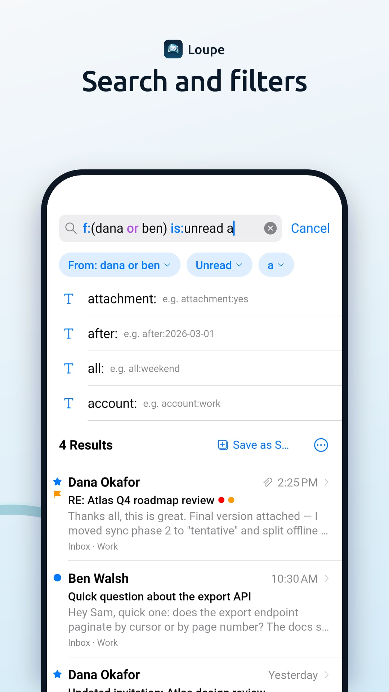
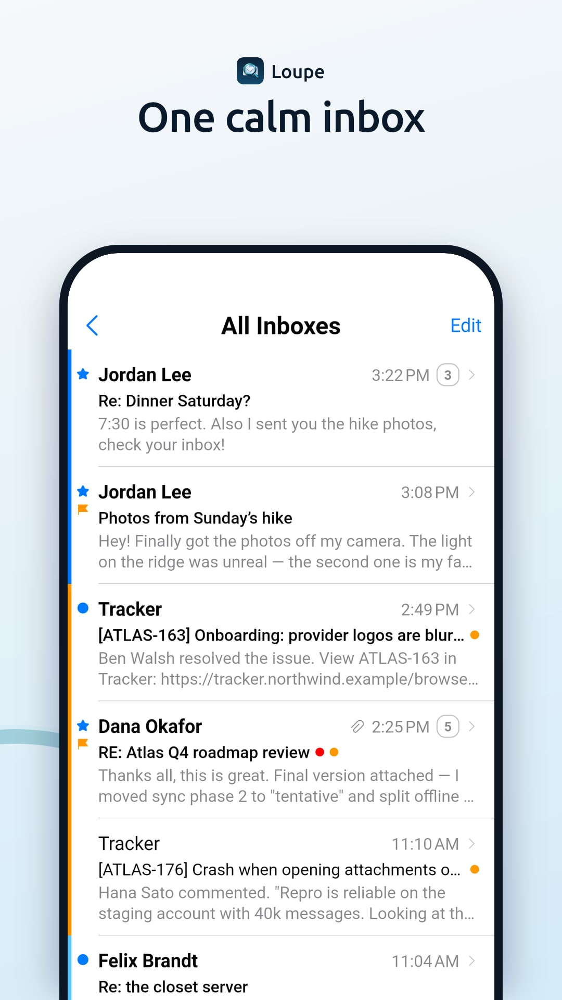
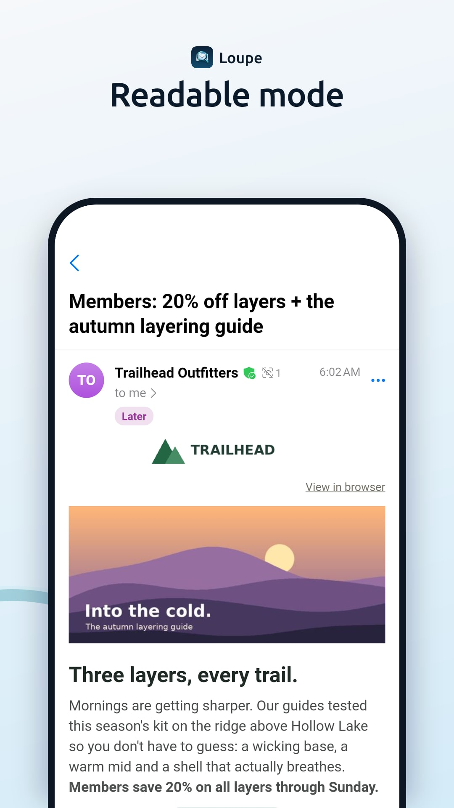
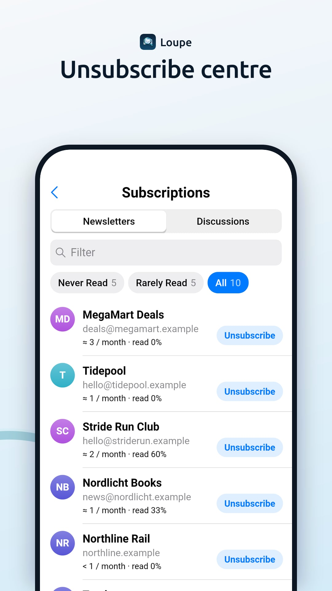

<!--TEMPLATE FOR NEW APP INCLUSION! For updates or other types of MRs replace the text below-->

## Abstract for new app inclusion

### Please introduce the functions and usage of your app in summary, and also attach some screenshots.

Loupe is an email app for IMAP/SMTP and JMAP accounts (Stalwart, Fastmail, Gmail, Outlook and any standard server). It aims to be simple on the surface, with desktop-class power underneath.

- **Reading:** "Readable" mode rebuilds HTML mail to fit the screen. Original and Plain views, an attachment viewer, and calendar invitations with Accept/Maybe/Decline.
- **Search:** chips or typed expressions (`f:alice and (s:invoice or b:"PO 123")`). Local results show at once and the server's follow. Smart Mailboxes are stored on the mail server.
- **Organising:** swipes with Undo, Thunderbird-compatible tags, snooze that works across mail apps, and an unsubscribe centre.
- **Rules:** device rules and server rules (Sieve over ManageSieve or JMAP); any search can become a rule.
- **Writing:** identities, catch-all aliases, draft autosave, undo send and scheduled send.
- **Security and privacy:** an encrypted local database (SQLite3 Multiple Ciphers), remote images blocked, tracking links unwrapped, an explainable phishing check, OpenPGP (Autocrypt, Thunderbird-compatible) and S/MIME, and optional App Lock. No telemetry, no servers of our own.
- **Also:** tablet three-pane layout and keyboard shortcuts; 37 languages; import from Thunderbird's "Export for Mobile" QR codes.

{width=180}
{width=180}
{width=180}
{width=180}

All screenshots: https://github.com/BuenGenio/loupe/tree/main/fastlane/metadata/android/en-US/images

### Please elaborate why you wrote this app. Please highlight the unique functions it provides over other similar apps in F-Droid.

I wanted a mail app as easy as Apple Mail with the power of Thunderbird desktop. Compared with the mail clients already on F-Droid, Loupe adds:

- a search language with a local matcher and server compilers for IMAP, Gmail and JMAP;
- Smart Mailboxes and snooze that follow you to other devices, through the mail server;
- making a server-side Sieve rule from any search;
- the Readable HTML mode;
- an explainable phishing check;
- JMAP and IMAP in one app.

## Checklist

### Policy

* [x] The app complies with the [inclusion policy](https://f-droid.org/docs/Inclusion_Policy). _Pay special attention to Quality point 6._
  * Quality point 6: Loupe has been actively developed since 4 October 2026; see the [commit history](https://github.com/BuenGenio/loupe/commits/main).
  * Free software (MPL-2.0), with no ads, tracking or non-free dependencies in this build. Loupe has two release types. This one ("Free") has no Google code. "NonFree" adds Firebase push for Google Play; its code lives in a separate directory that this recipe removes (`rm: nonfree`).
* [x] The original app author has been notified (and does not oppose the inclusion). If you are not the author, please paste the link of the reply from the author.
  * I am the author.
* [x] The upstream app source code repo contains the app metadata in a [Fastlane](https://gitlab.com/snippets/1895688) or [Triple-T](https://gitlab.com/snippets/1901490) folder structure. The summary and description must be included and images, icon, and changelog should also be provided for better user experience. The `en-US` locale must be included.
  * `fastlane/metadata/android/`: en-US with title, summary, description, icon, feature graphic, phone and tablet screenshots and changelogs; 32 more locales.

### Docs

* [x] Please read [the guide](https://gitlab.com/fdroid/fdroiddata/-/blob/master/CONTRIBUTING.md) first if this is your first contribution.
* [x] Please make sure your metadata follows the best practice in [our templates](https://gitlab.com/fdroid/fdroiddata/tree/master/templates).
  * Based on `templates/build-flutter.yml`: Flutter as the `.flutter` submodule, the pub cache inside the build directory.
* [x] Please read the [Build Metadata Reference](https://f-droid.org/docs/Build_Metadata_Reference/) and make sure your metadata is valid.
  * `fdroid lint` and `fdroid rewritemeta` are clean.
* [x] Please read the [Quick Start Guide](https://f-droid.org/en/docs/Submitting_to_F-Droid_Quick_Start_Guide/).

### Merge Request Setup

* [x] The title of this merge request should follow "New app: app name" format.
* [x] Please make sure your fdroiddata fork is public and your branch is not protected. See <https://docs.gitlab.com/user/project/repository/branches/protected/>.
* [x] Please read [our Git guide](https://gitlab.com/fdroid/wiki/-/wikis/Tips-for-fdroiddata-contributors/Git-Usage) if you don't know how to rebase your branch. Don't rebase your branch if there is no conflict.
* [x] All related [fdroiddata](https://gitlab.com/fdroid/fdroiddata/issues) and [RFP issues](https://gitlab.com/fdroid/rfp/issues) have been referenced in this merge request
  * There are none.
* [x] Please only submit one app in one MR.

### Metadata

* [x] Metadata must be put in `metadata/<applicationId>.yml`.
* [x] Metadata must be a valid YAML file.
* [x] Metadata must use LF as line ending.
* [x] Don't add summary/description/changelog/images or anything that should be provided in upstream repo. Please check the Changes tab to make sure there is no other unrelated files added in the MR.
* [x] Releases are tagged and auto update is enabled unless there is a special reason.
  * Tags `vX.Y.Z`; `UpdateCheckData` reads the version from `app/pubspec.yaml`.
* [x] There is an issue tracker and contact info of the author so that we can report bugs and contact the author.
* [x] An AuthorName must be added. It doesn't need to be the real name.
* [x] External repos are added as git submodules instead of srclibs. You can update git submodules without opening an MR in this repo and the submodule is covered by our scanner.
  * Flutter is the `.flutter` submodule. SQLite3 Multiple Ciphers is vendored as source in `third_party/sqlite3mc` and compiled by package:sqlite3's build hook, not downloaded.
* [x] Enable [Reproducible Builds](https://f-droid.org/docs/Reproducible_Builds). We'll use your signature for improved security/reliability, also allowing users to switch between different channels. Do note that if you don't enable reproducible build then the apk will be signed with our key so you can't enable it later. If you can't enable this, please add the reasons here.
  * `binary:` and `AllowedAPKSigningKeys` are set. Upstream's release workflow builds at the recipe's path, with the same Flutter submodule, pub cache location and JDK, and with the Android SDK in `/opt/android-sdk` holding only the recipe's NDK. Upstream CI rebuilds each release in the `fdroidserver:buildserver` container with `fdroid build --on-server` and compares it with the published APKs.
* [x] Setup abi split if the APK is large and the splitted ones can be much smaller.
  * armeabi-v7a, arm64-v8a and x86_64. The version code is `10 * build number + 1/2/4`, with the ABI in the last digit.
* [x] Only the latest versions should be kept in the metadata before it's merged. If you update the metadata, please replace the old versions with the new ones.
* [x] Don't add any disabled versions in the metadata.
* [x] The `commit` field should be the full hash. Please don't use tag or branch in commit.

### Pipeline

* [x] All pipelines should pass.
* [x] All warnings and errors in the Reports tab should be fixed or explained.
  * `INTERNET`: it's a mail app.
  * `CAMERA`: scanning Thunderbird's "Export for Mobile" QR codes when importing accounts. It is asked for only when the scanner opens, and the camera isn't required (`uses-feature` with `required="false"`; the import also takes pasted text).
  * `FOREGROUND_SERVICE_SPECIAL_USE`, `WAKE_LOCK`, `RECEIVE_BOOT_COMPLETED`: Instant Delivery, an optional mode that is off by default. It keeps an IMAP IDLE connection to the user's own server open, because standard IMAP servers have no push service.
  * Launcher badge permissions (Samsung, Huawei, Honor, Sony, HTC, vivo and others): the unread count on the app icon (app_badge_plus).
  * `USE_BIOMETRIC` / `USE_FINGERPRINT`: App Lock, off by default.
* [x] F-Droid CI runners are under GitLab's FOSS program, so there's no need for you to pay for any CI time. If Gitlab starts asking for phone numbers or credit cards don't submit anything, just leave a note in the MR so we know we need to trigger the CI.

---------------------

/label ~"New App"
